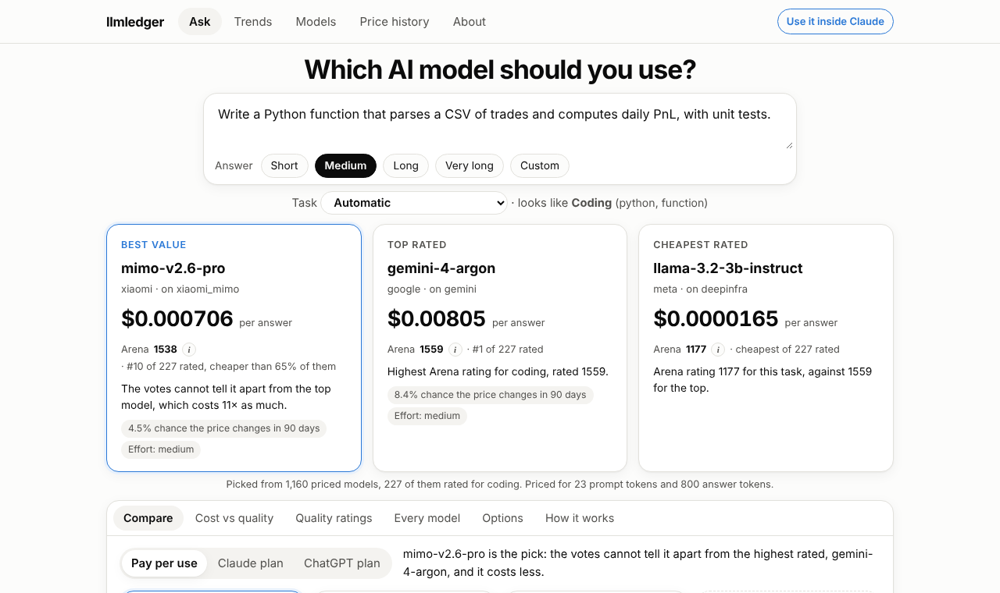

# llmledger

**Which AI model should you use, and what will it cost?** Paste a prompt and get the best value
model for it, the top rated one and the cheapest rated one, with what each costs and the chance
its price changes in the next 90 days. Behind it: every price change in LiteLLM's model catalogue
since 2023 (4,200+ models), Arena's quality ratings, and a competing risks survival model, rebuilt
every day.

[](https://github.com/pouriaetab/llmledger/actions/workflows/tests.yml)
[](https://github.com/pouriaetab/llmledger/actions/workflows/refresh.yml)
[](https://pypi.org/project/llmledger-mcp/)
[](LICENSE)

[](https://github.com/BerriAI/litellm)
[](https://doi.org/10.5281/zenodo.23330454)

**Try it:** https://pouriaetab.github.io/llmledger/ (no sign up, the prompt stays in your browser)

[](https://pouriaetab.github.io/llmledger/)

## Use it inside Claude

The same answers inside Claude Code, Claude Desktop, Cursor or any app that speaks MCP. Nothing to host, no keys:

```bash
claude mcp add llmledger -- uvx llmledger-mcp
```

Ten tools: suggest a model and effort level for a project, compare models side by side, estimate a budget, find models
within limits, a model's price history with its outlook, new models not priced yet, how long a job takes (learned from
your own runs), a quote for a whole job from a promptfoo sample, and whether buying a computer to run an open model
pays off. Other apps and details: [mcp/README.md](mcp/README.md).

As an Agent Skill, which stays out of the context until it is used (about 150 tokens against well over 1,000 for the
plug-in's tools) and needs only Python:

```text
/plugin marketplace add pouriaetab/llmledger
/plugin install llmledger@llmledger
```

or `npx skills add pouriaetab/llmledger`, or copy [skills/llmledger](skills/llmledger) into your agent's skills folder.

## What you get

- **Ask.** Paste a prompt, see the best value model, the top rated and the cheapest rated for its task (coding, math,
  writing, 7 fields, 7 languages, images, documents, websites), with the cost per answer and the chance of a price
  change. The task is guessed from the prompt, in the browser.
- **Compare.** Up to five models side by side: Arena rating, prices, cost per task, effort levels, or how fast each uses
  a Claude or ChatGPT plan. Cost against quality, with the models no other model beats on both.
- **Models.** Every model in the catalogue, as LiteLLM lists it or grouped by model, with its price history, every
  change linked to the LiteLLM commit behind it, and its outlook.
- **Trends.** Two years of Arena leaderboards replayed: the best open model against the best closed one, the top
  makers, and what top quality has cost.
- **Price history.** How likely a newly listed model is to have its price changed, get a retirement date or be removed,
  within 30 days to 2 years, with and without the catalogue's own corrections.
- **A feed.** [feed.xml](https://pouriaetab.github.io/llmledger/feed.xml): every price change and retirement date, one
  entry a day. The data behind everything: [data.json](https://pouriaetab.github.io/llmledger/data.json).

The full list, one line per feature: [docs/FEATURES.md](docs/FEATURES.md).

> **Not financial or procurement advice.** The numbers describe edits to a public catalogue, not what any model costs
> you. See [DISCLAIMER.md](DISCLAIMER.md).

## What the data says

A snapshot; the live page has the current numbers. The short version: **about 6 in 10 "price changes" in the
catalogue are corrections of the catalogue, not price changes**, and once those are set aside about 1 model in 10 has
its price changed within a year of being listed.

5,256 models added after the catalogue's first recorded version
(6 September 2023), followed until 13 October 2026. Each cell is the estimated
share of models whose first exit was this one, with its 95% confidence interval.

| Within | Price change | Retirement announced | Removed | None of these |
|:--|--:|--:|--:|--:|
| 1 year | 14.7% (13.5 to 15.9) | 16.4% (15.2 to 17.7) | 16.3% (15.3 to 17.4) | 52.6% (50.9 to 54.3) |
| 2 years | 18.3% (16.9 to 19.7) | 29.5% (27.6 to 31.4) | 23.4% (21.7 to 25.0) | 28.8% (26.8 to 31.2) |

Each row adds up to 100% because the three exits compete: once a model is
removed, its price can no longer change. Analysing each exit on its own would
overstate all three.

Counting only input and output token prices, the one year price change estimate
is 12.5%. Ignoring price changes in a model's first week, it is 12.0%. Many of
the changes counted are corrections of the catalogue, not real price changes:
see the next section. On the data of 18 October 2026, leaving out likely
corrections as well as unit fixes and undone changes, it is 10.0% (9.1 to
11.1), against 14.6% (13.5 to 15.7) counting every change; that still counts
some corrections.

Corrections and clean ups matter more for removals. The one year removal
estimate above includes a clean up that removed about 500 OpenRouter rows on
9 October 2026. Leaving out bulk clean ups, unit fixes and reverted changes, it
is 5.7% (5.0 to 6.5).

### How many first price changes are corrections?

A stratified random sample of 200 models' first price changes (100 from a
model's first 7 days, 100 from later, out of 800) was labelled from the LiteLLM
commit behind each change: a correction when the catalogue's number had been
wrong, a repricing when the host changed its price, unclear when the evidence
cannot tell (33 rows). The guide, every label and its reason are in
[`docs/corrections`](docs/corrections); the numbers are in
`src/llmledger/corrections_eval.json`. Intervals are 95%, from a bootstrap of
whole LiteLLM commits, since one commit often changes many rows.

| First price changes | Share that are corrections |
|:--|--:|
| All | 59% (41 to 75) |
| In a model's first 7 days | 86% (54 to 97) |
| Later | 51% (34 to 71) |

How well simple rules find the corrections:

| Rule | Precision | Recall |
|:--|--:|--:|
| The page's tags (unit fixes, reverted changes) | 93% (51 to 100) | 36% (5 to 59) |
| Any first change in the first 7 days | 86% (54 to 97) | 30% (11 to 53) |
| Either of the two | 87% (60 to 96) | 46% (19 to 66) |
| First 7 days, or a change of 10 times or more | 92% (76 to 98) | 55% (30 to 73) |
| A small model (cross-validated logistic regression) | 76% (57 to 89) | 78% (59 to 90) |

So about six in ten first price changes correct the catalogue rather than
reprice the model, and corrections are common after the first week too. The
tags miss most of them. Counting the unclear rows as repricings instead, the
share is 46%; counting them as corrections, 70%.

Since version 1.12 the page tags the fourth rule as a **likely correction**
and gives every estimate without those changes too. It does not find them
all: of the first price changes it does not tag, about 40% (24 to 61) are
still corrections, so even that estimate overstates how often a host really
changes a price.

## How it works

1. **Rebuilds the history.** Reads every version of `model_prices_and_context_window.json` that LiteLLM's `main`
   branch went through, in order, using git, and writes one row per change (`data/events.csv`).
2. **Estimates competing risks.** Follows each newly added model until its first exit and estimates the chance of each
   with the Aalen-Johansen estimator and 95% bootstrap intervals (`data/survival.csv`). Checked a second time in SQL
   every run; the build stops if SQL and Python disagree on any model.
3. **Publishes.** The page, `data.json` and `feed.xml`, every day, after a licence check of every outside source and a
   check that the new build is not a step back from the live page.

The full method is in [docs/SPEC.md](docs/SPEC.md): definitions, numbered requirements, known limitations, and a
traceability table linking each requirement to the test that verifies it. The model, in short:

1. **Subject:** a model added after the catalogue's first version. Time zero is
   the moment it was added.
2. **Exit:** the first of a price change, a retirement date being set, or
   removal. When two happen in the same version, removal counts first, then
   retirement.
3. **Censored:** no exit by the end of the history.
4. **Estimator:** Aalen-Johansen cumulative incidence for each exit, reported
   only while at least 100 models are still being followed.
5. **Uncertainty:** 1,000 bootstrap resamples of the models with a fixed seed,
   so every run gives identical output.
6. **Checked on simulated data:** on 200 simulated datasets per setting,
   with exit rates chosen in advance, the largest bias is 0.0015 and the
   95% intervals contain the true value in 91% to 98% of datasets.

## Run it yourself

Python 3.14.7 (pinned in `.python-version`; 3.12 or newer works), standard
library only, plus pyarrow (pinned in `requirements.txt`) to read Arena's past
leaderboards for the Trends view; without it the page is built without the
trend charts. One command downloads LiteLLM's history, rebuilds everything and
writes the results page:

```bash
PYTHONPATH=src python -m llmledger.pipeline    # writes data/ and site/index.html
PYTHONPATH=src python -m llmledger.simulate    # simulation check, about 2 minutes
```

Before it writes the page, the pipeline compares its data with the live page
and stops if the new build is a step back (fewer models, a quarter fewer
listed, or older data). Set `LLMLEDGER_SKIP_LIVE_CHECK=1` to publish anyway,
for example after LiteLLM rewrites its history.

Tests (197 in `tests/`, 32 more for the plug-in in `mcp/tests`; the ones that run the page's JavaScript need
Node.js and are skipped without it), with the exact versions pinned in `requirements.txt`:

```bash
python -m pip install -r requirements.txt
python -m pytest
```

## Cite

Use the "Cite this repository" button on GitHub, which reads
[CITATION.cff](CITATION.cff). Archived on Zenodo:
[10.5281/zenodo.23330454](https://doi.org/10.5281/zenodo.23330454) always
points to the newest version; version 1.0.0 is
[10.5281/zenodo.23330455](https://doi.org/10.5281/zenodo.23330455).

## Data source

The data is the git history of
[`model_prices_and_context_window.json`](https://github.com/BerriAI/litellm/blob/main/model_prices_and_context_window.json)
in [BerriAI/litellm](https://github.com/BerriAI/litellm), used under its MIT
licence. The history is cloned to your own machine and is not redistributed
here. llmledger is independent and not affiliated with or endorsed by BerriAI.

Quality ratings on the Best value tab come from the
[Arena leaderboard dataset](https://huggingface.co/datasets/lmarena-ai/leaderboard-dataset)
by LMArena, used under CC BY 4.0 and read once a day; the Trends view reads
its full history of past leaderboards from the same dataset. The task guess is
measured on prompts from Arena's
[human preference dataset](https://huggingface.co/datasets/lmarena-ai/arena-human-preference-140k),
also CC BY 4.0. llmledger is not affiliated with or endorsed by LMArena.

Electricity prices for the plug-in's local or cloud answer come from the U.S.
Energy Information Administration's
[Electric Power Monthly](https://www.eia.gov/electricity/monthly/), Table 5.6.A
(average price for homes, by state), a U.S. government work in the public
domain, read once a day with its month in the credit line.

## Layout

```
src/llmledger/       history.py, events.py, flags.py (corrections),
                     survival.py, survival.sql and sql.py (SQL check),
                     simulate.py,
                     outlook.py (one model's outlook), names.py (grouping),
                     catalog.py (page data), page.py, page.html, app.js,
                     cost.js (prompt cost), arena.py (quality ratings),
                     licences.py (daily licence check), route.js and
                     route_eval.py (task guess and how often it is right),
                     pick.js (compare side by side), export.py (data.json),
                     trends.py and trends.js (the Trends view, cost vs quality),
                     corrections.py (how many price changes are corrections),
                     unpriced.py (models seen on Arena, not yet priced),
                     guard.py (no step back from the live page),
                     table_protocol.js (results page), pipeline.py
tests/               known answer, simulation, naming, page and version tests
mcp/                 the plug-in (llmledger-mcp): FastMCP server, tests, server.json
skills/llmledger/    the Agent Skill: SKILL.md and a script with a copy of the
                     plug-in's code (tools.py, logic.py, data.py, speed.py, forecast.py)
.claude-plugin/      the Claude Code marketplace entry for the skill
docs/SPEC.md         definitions, requirements, limitations, traceability
docs/corrections/    labelling guide and the labelled sample (issue #7)
docs/promptfoo.md    checking the plug-in with promptfoo, timing jobs from its runs,
                     and quoting a whole job from a sample
.github/workflows/   tests on every pull request; refresh rebuilds and
                     publishes the results page every day, and opens an
                     issue when it fails
```

Built with an AI pair programmer (Claude); the specification, the statistical
design and the conclusions were reviewed by the author.

MIT licence.
